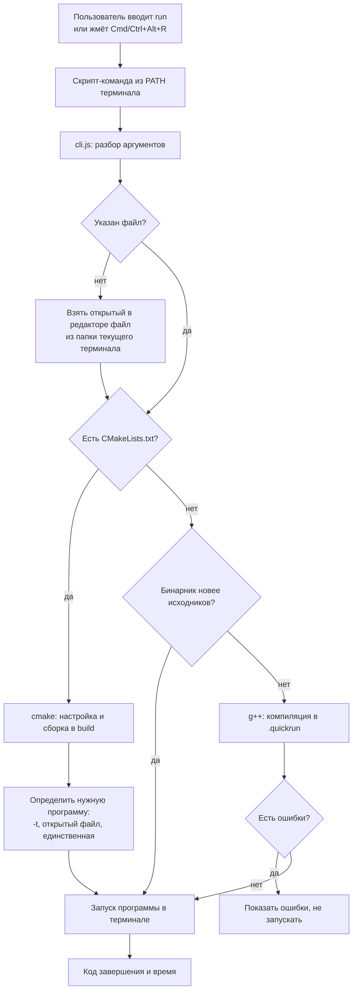

# QuickRun: плагин для VS Code

**Автор:** [Молоствов Максим Андреевич], группа [М3118]
**IDE:** Visual Studio Code
**Язык:** JavaScript (Node.js), VS Code Extension API ≥ 1.80
**Лицензия:** MIT

> **Использование ИИ.** При выполнении работы использовалась нейросеть **Claude (Anthropic)**.
> С её помощью написан исходный код плагина (`src/extension.js`, `src/cli.js`, `package.json`),

## 1. Назначение
Плагин убирает ручную рутину «сохранить → собрать → запустить» для C++ проектов.
Пользователь пишет код и вводит в терминале VS Code короткую команду (по умолчанию `run`),
после чего плагин сам собирает проект и запускает программу в том же терминале.
Длинные команды сборки вводить не нужно.

## 2. Функциональные требования
1. Короткая команда `run` в встроенном терминале VS Code (имя настраивается).
2. Те же действия доступны через палитру команд («QuickRun: Собрать и запустить»),
   горячую клавишу **Ctrl+Alt+R** (**Cmd+Option+R** на macOS) и кнопку **QuickRun** в статус-баре.
3. Автосохранение изменённых C/C++ файлов через 0,5 с после правки; перед запуском из редактора
   дополнительно сохраняются все файлы.
4. Команда `run` без аргументов запускает **файл, открытый в редакторе**, если он лежит в текущей папке терминала.
   Иначе используется `main.cpp` или единственный файл с `main()`.
5. Два режима сборки:
   - **Прямой** (нет `CMakeLists.txt`): компилируется главный файл и все остальные `.cpp` проекта, в которых нет `main()`.
     Результат кладётся в скрытую папку `.quickrun`.
   - **CMake** (есть `CMakeLists.txt`): настройка и сборка в папке `build`, поиск нужной программы среди собранных.
6. Пропуск ненужной сборки: если бинарник новее всех исходников и заголовков, пересборка не выполняется.
7. Вывод ошибок и предупреждений компилятора с подсчётом их числа; при ошибке программа не запускается,
   устаревший бинарник удаляется.
8. Запуск программы в том же терминале с поддержкой ввода с клавиатуры; вывод кода завершения и времени работы.
9. Параметры команды:
   - `run файл.cpp`: собрать и запустить указанный файл;
   - `run .`: игнорировать открытый файл;
   - `run -r`: принудительная пересборка;
   - `run -t имя`: выбрать программу в CMake-проекте;
   - `run -- a b`: передать аргументы программе;
   - `run -h`: справка.
10. В CMake-проекте с несколькими программами выбор происходит так: явное имя (`-t`) → программа, в исходниках
    которой есть открытый файл → единственная собранная. Если неоднозначно, выводится список программ.

## 3. Настройки (`Settings → QuickRun`)
| Параметр | По умолчанию | Описание |
|---|---|---|
| `quickrun.compiler` | `g++` | Компилятор |
| `quickrun.flags` | `["-std=c++17", "-Wall"]` | Флаги компиляции |
| `quickrun.commandName` | `run` | Имя команды в терминале |
| `quickrun.autoSave` | `true` | Автосохранение C/C++ файлов |

Команду `start` использовать не рекомендуется: в PowerShell и cmd это встроенная команда.

## 4. Архитектура
Плагин состоит из двух частей.

- **`src/extension.js`**: интеграция с VS Code. При запуске создаёт скрипт-команду и добавляет его папку в `PATH`
  встроенных терминалов (через `environmentVariableCollection`), передаёт настройки через переменные окружения,
  регистрирует команду, горячую клавишу и кнопку статус-бара, запоминает открытый `.cpp` файл, выполняет автосохранение.
- **`src/cli.js`**: консольная часть на Node.js, не зависящая от VS Code. Определяет, что собирать, собирает и запускает.
  Скрипт-команда запускает её с помощью движка самого VS Code (`ELECTRON_RUN_AS_NODE`), поэтому отдельная установка Node.js не нужна.

## 5. Логика и структуры данных
- `Map` отложенных таймеров автосохранения (ключ: адрес файла), сброс таймера при новой правке (debounce).
- `Map` переменных и циклов из `CMakeLists.txt` (`set`, `project`, `foreach`) для подстановки в `add_executable(${name} ...)`.
- `Set` игнорируемых папок и расширений исходников, заголовков и не-программ.
- Рекурсивный обход проекта: поиск исходников, заголовков и исполняемых файлов.
- Выбор исходников для сборки: главный файл плюс все `.cpp` без `main()`.
- Разбор вывода компилятора регулярными выражениями: подсчёт ошибок и предупреждений, имена программ из `Built target …`.
- Сравнение времени изменения (`mtime`) бинарника и исходников для пропуска сборки.
- Запасной поиск программы: если имена неизвестны, берутся все исполняемые файлы папки `build`.

## 6. Нефункциональные требования
- Работа на macOS (проверено), Linux и Windows (реализована поддержка `.cmd`-скрипта, `.exe`, генератора MinGW; не проверялась).
- Ошибки сообщаются понятным текстом на русском языке; недоступные папки при поиске пропускаются.
- Код документирован комментариями JSDoc; документация генерируется командой `npm run docs`.

## 7. Установка и запуск
1. Для разработки: открыть папку проекта в VS Code, выбрать **Run → Start Debugging**. Откроется окно с плагином.
2. Для установки: `npm install`, `npm run package`, затем в VS Code **Extensions → ⋯ → Install from VSIX…**.
3. Открыть новый терминал (после установки и после смены настроек) и ввести `run`.

## 8. Требования к окружению и ограничения
- Установленный компилятор C++ (`g++` или `clang++`) в `PATH`; для CMake-проектов нужен `cmake`.
- Настройки применяются только в новых терминалах.
- Автовыбор программы по открытому файлу работает, если файл лежит в текущей папке терминала или глубже.
- Сборка директивой `run` не заменяет полноценную отладку.

## 9. Сценарий использования
1. Открыть в VS Code папку проекта и нужный `.cpp` файл, написать код.
2. Ввести в терминале `run`.
3. Плагин собирает проект (или пропускает сборку, если ничего не менялось) и запускает программу.
4. При ошибках компиляции в терминале показаны сообщения, программа не запускается.
